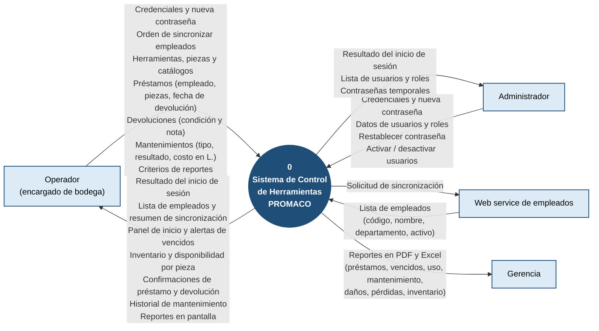

# Diagrama de contexto (nivel 0)

**Sistema de Control de Herramientas · PROMACO**

El diagrama de contexto muestra el sistema completo como **un solo proceso** y las **entidades externas**
que intercambian información con él. No muestra cómo funciona por dentro: eso corresponde a los
[diagrama de flujo de datos de nivel 1](diagrama-nivel1.md) y a los [diagramas de actividad](diagramas-actividad.md).

Versión en imagen (para documentos impresos o presentaciones): [`diagrama-contexto.png`](diagrama-contexto.png).

Notación:

- Círculo: el sistema, como proceso único (proceso 0).
- Rectángulo: entidad externa (persona, área o sistema que está fuera del alcance del sistema).
- Flecha: flujo de datos; la etiqueta dice qué información viaja y la punta indica hacia dónde.

## Entidades externas

| Entidad | Qué le entrega al sistema | Qué recibe del sistema |
|---|---|---|
| **Operador** (encargado de bodega) | Credenciales y cambio de contraseña; orden de sincronizar empleados; registro de herramientas, piezas y catálogos (categorías, marcas, ubicaciones, proveedores); préstamos; devoluciones con su condición (Bueno, Dañado, Perdido); mantenimientos con su costo en lempiras; filtros de reportes. | Resultado del inicio de sesión, lista de empleados con el resumen de la sincronización, panel de inicio, alertas de préstamos vencidos, inventario y estado de cada pieza, confirmaciones, historial de mantenimiento y reportes. |
| **Administrador** | Lo mismo que el Operador y, además, los datos de usuarios, roles, restablecimientos de contraseña y activaciones. | Lo mismo que el Operador y, además, la lista de usuarios y las contraseñas temporales. |
| **Web service de empleados** | La lista de empleados de la empresa (por eso no se registran a mano). | La solicitud de sincronización. |
| **Gerencia** | — | Reportes exportados a PDF y Excel para tomar decisiones de compra, reposición y control de gastos. |

## Lo que queda fuera del diagrama, y por qué

- **Empleados que piden herramientas.** No usan el sistema: piden la herramienta en bodega y el
  Operador registra el préstamo a su nombre. Por eso sus datos entran a través del Operador y del
  Web service de empleados, no como una entidad aparte.
- **Proveedores de mantenimiento.** Tampoco usan el sistema: entregan la factura y el Operador registra
  el mantenimiento externo con su costo.
- **Base de datos (SQL Server).** Es parte del sistema, no una entidad externa; aparece en el
  [diagrama de nivel 1](diagrama-nivel1.md) dividida en almacenes de datos.

Para simplificar el diagrama, el Administrador aparece solo con los flujos que lo distinguen del
Operador; también puede realizar todo lo que hace el Operador.
