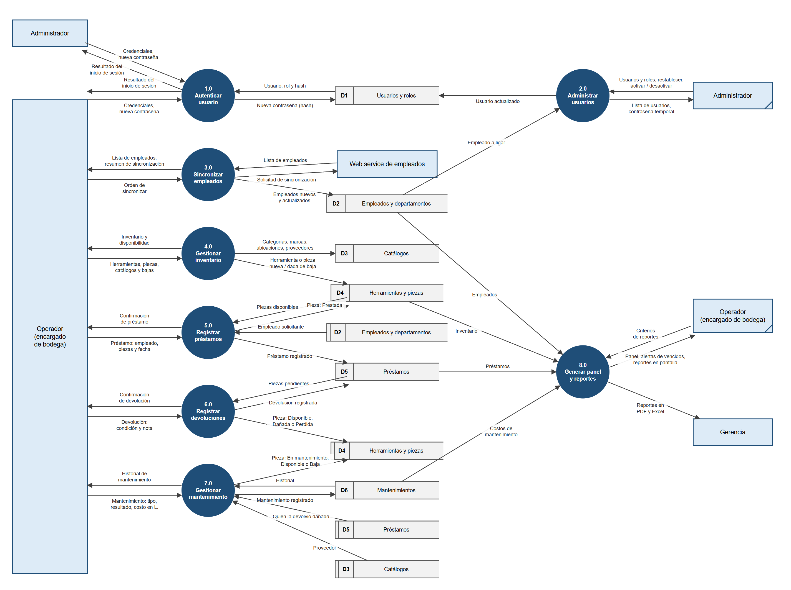

# Diagrama de flujo de datos (nivel 1)

**Sistema de Control de Herramientas · PROMACO**

El nivel 1 abre el proceso único del [diagrama de contexto](diagrama-contexto.md) y lo divide en sus
**procesos principales**, mostrando los **almacenes de datos** donde se guarda la información. Las
entidades externas y los flujos que entran y salen del sistema son los mismos del diagrama de
contexto (los diagramas están **balanceados**).

Versiones para imprimir: [`diagrama-nivel1.png`](diagrama-nivel1.png) y
[`diagrama-nivel1.svg`](diagrama-nivel1.svg) (vectorial, no pierde calidad al ampliar).

Para modificar el diagrama: edite los textos en [`fuentes/diagrama-nivel1.py`](fuentes/diagrama-nivel1.py)
y vuelva a generarlo con `python fuentes/diagrama-nivel1.py diagrama-nivel1.svg`; el PNG se obtiene del
SVG con [`fuentes/svg-a-png.js`](fuentes/svg-a-png.js) (requiere Node y Puppeteer).

## Notación

| Símbolo | Significado |
|---|---|
| Rectángulo celeste | Entidad externa. Con una **línea diagonal en la esquina** es una copia de una entidad que ya aparece en el diagrama; se duplica solo para no cruzar flechas. |
| Círculo azul con número | Proceso. |
| Rectángulo abierto con identificador (D1, D2…) | Almacén de datos. Con una **línea vertical extra** junto al identificador es una copia de un almacén que ya aparece. |
| Flecha con etiqueta | Flujo de datos; la etiqueta dice qué información viaja. |

## Procesos

| # | Proceso | Qué hace | Lee de | Escribe en |
|---|---|---|---|---|
| 1.0 | Autenticar usuario | Valida usuario y contraseña (hash PBKDF2), obliga a cambiar la contraseña temporal y permite cambiar la propia. | D1 | D1 |
| 2.0 | Administrar usuarios | Crea y edita usuarios ligados a un empleado, asigna roles, restablece contraseñas, activa y desactiva. Solo Administrador. | D2 | D1 |
| 3.0 | Sincronizar empleados | Pide la lista de empleados al Web service de empleados y agrega o actualiza los que cambiaron. | — | D2 |
| 4.0 | Gestionar inventario | Registra catálogos, herramientas y piezas, y da de baja herramientas y piezas. | — | D3, D4 |
| 5.0 | Registrar préstamos | Presta piezas disponibles a un empleado con fecha de devolución; cada pieza pasa a *Prestada*. | D2, D4 | D4, D5 |
| 6.0 | Registrar devoluciones | Recibe piezas de un préstamo con su condición; cada pieza queda *Disponible*, *Dañada* o *Perdida*. | D5 | D4, D5 |
| 7.0 | Gestionar mantenimiento | Abre y cierra mantenimientos (interno o externo) con su costo en lempiras; la pieza queda *En mantenimiento*, vuelve a *Disponible* o se da de *Baja*. | D3, D5, D6 | D4, D6 |
| 8.0 | Generar panel y reportes | Arma el panel de inicio, las alertas de vencidos y los reportes, y los exporta a PDF y Excel. | D2, D4, D5, D6 | — |

## Almacenes de datos

| Almacén | Tablas de la base de datos |
|---|---|
| D1 Usuarios y roles | `Usuario`, `Rol` |
| D2 Empleados y departamentos | `Empleado`, `Departamento`, `SincronizacionEmpleados` |
| D3 Catálogos | `CategoriaHerramienta`, `Marca`, `Ubicacion`, `Proveedor` |
| D4 Herramientas y piezas | `Herramienta`, `HerramientaUnidad` |
| D5 Préstamos | `Prestamo`, `PrestamoDetalle` |
| D6 Mantenimientos | `Mantenimiento` |

El detalle de cada tabla está en el [diagrama entidad-relación](diagrama-er.md).

## Balanceo con el diagrama de contexto

Cada flujo del diagrama de contexto aparece aquí, conectado al proceso que lo atiende:

| Entidad | Flujo del contexto | Proceso en nivel 1 |
|---|---|---|
| Operador / Administrador | Credenciales y nueva contraseña → Resultado del inicio de sesión | 1.0 |
| Administrador | Datos de usuarios y roles, restablecer, activar/desactivar → Lista de usuarios, contraseñas temporales | 2.0 |
| Operador | Orden de sincronizar empleados → Lista de empleados y resumen | 3.0 |
| Web service de empleados | Solicitud de sincronización → Lista de empleados | 3.0 |
| Operador | Herramientas, piezas y catálogos → Inventario y disponibilidad | 4.0 |
| Operador | Préstamos → Confirmación de préstamo | 5.0 |
| Operador | Devoluciones → Confirmación de devolución | 6.0 |
| Operador | Mantenimientos → Historial de mantenimiento | 7.0 |
| Operador | Criterios de reportes → Panel, alertas y reportes en pantalla | 8.0 |
| Gerencia | Reportes en PDF y Excel | 8.0 |

El Administrador también puede usar los procesos 3.0 a 8.0 como cualquier Operador. Para no repetir
flechas, en el diagrama solo aparece en los procesos que lo distinguen (1.0 y 2.0).
