# Diagramas de actividad

**Sistema de Control de Herramientas · PROMACO**

Cada diagrama tiene dos carriles: el **actor** (Operador o Administrador) y el **Sistema**.
Notación usada:

- Círculo negro: inicio. Círculo negro con borde grueso: fin.
- Rectángulo redondeado: actividad.
- Rombo: decisión (las condiciones van en las flechas).

El **Administrador** puede realizar todas las actividades del Operador (diagramas 1 a 13) y, además,
las de administración de usuarios (diagramas 14 a 17).

| # | Proceso | Actor |
|---|---|---|
| 1 | Iniciar sesión | Operador / Administrador |
| 2 | Cambiar contraseña | Operador / Administrador |
| 3 | Consultar panel de inicio | Operador / Administrador |
| 4 | Registrar catálogos | Operador / Administrador |
| 5 | Registrar herramientas | Operador / Administrador |
| 6 | Registrar piezas | Operador / Administrador |
| 7 | Dar de baja herramientas y piezas | Operador / Administrador |
| 8 | Consultar inventario | Operador / Administrador |
| 9 | Registrar préstamos | Operador / Administrador |
| 10 | Registrar devoluciones | Operador / Administrador |
| 11 | Registrar mantenimiento | Operador / Administrador |
| 12 | Consultar historial de mantenimiento | Operador / Administrador |
| 13 | Generar y exportar reportes | Operador / Administrador |
| 14 | Crear usuarios | Administrador |
| 15 | Asignar roles | Administrador |
| 16 | Restablecer contraseñas | Administrador |
| 17 | Activar y desactivar usuarios | Administrador |

---

## 1. Iniciar sesión

```mermaid
flowchart TD
    subgraph U["Operador / Administrador"]
        I((" ")):::ini
        A1("Abrir el sistema")
        A2("Ingresar usuario y contraseña")
        A3("Cambiar la contraseña temporal<br/>(ver diagrama 2)")
        D3{"¿Cambió la<br/>contraseña?"}
    end
    subgraph S["Sistema"]
        S0("Mostrar pantalla de inicio de sesión")
        D1{"¿Campos<br/>completos?"}
        M1("Mostrar: Ingrese usuario y contraseña")
        D2{"¿Credenciales correctas<br/>y usuario activo?"}
        M2("Mostrar: Usuario o contraseña incorrectos")
        D4{"¿Contraseña<br/>temporal?"}
        S5("Cerrar la sesión")
        D5{"¿Rol con permiso de<br/>administrar usuarios?"}
        S6("Mostrar menú completo<br/>incluido el módulo Usuarios")
        S7("Mostrar menú sin el módulo Usuarios")
        S8("Mostrar panel de inicio")
        F((("  "))):::fin
    end

    I --> A1 --> S0 --> A2 --> D1
    D1 -->|No| M1 --> A2
    D1 -->|Sí| D2
    D2 -->|No| M2 --> A2
    D2 -->|Sí| D4
    D4 -->|Sí| A3 --> D3
    D3 -->|No| S5 --> S0
    D3 -->|Sí| D5
    D4 -->|No| D5
    D5 -->|"Sí (Administrador)"| S6 --> S8
    D5 -->|"No (Operador)"| S7 --> S8
    S8 --> F

    classDef ini fill:#000,stroke:#000
    classDef fin fill:#000,stroke:#000,stroke-width:4px
```

## 2. Cambiar contraseña

```mermaid
flowchart TD
    subgraph U["Operador / Administrador"]
        I((" ")):::ini
        A1("Seleccionar Mi contraseña")
        A2("Ingresar contraseña actual,<br/>nueva contraseña y confirmación")
        A3("Presionar Guardar contraseña")
    end
    subgraph S["Sistema"]
        D1{"¿La confirmación<br/>coincide?"}
        D2{"¿La nueva es distinta<br/>de la actual?"}
        D3{"¿Cumple las reglas?<br/>8 caracteres o más, letras y<br/>números, sin el nombre de usuario"}
        D4{"¿La contraseña actual<br/>es correcta?"}
        M1("Mostrar el error en el formulario")
        S1("Guardar la nueva contraseña protegida")
        S2("Mostrar: Contraseña actualizada")
        F((("  "))):::fin
    end

    I --> A1 --> A2 --> A3 --> D1
    D1 -->|No| M1
    D1 -->|Sí| D2
    D2 -->|No| M1
    D2 -->|Sí| D3
    D3 -->|No| M1
    D3 -->|Sí| D4
    D4 -->|No| M1
    M1 --> A2
    D4 -->|Sí| S1 --> S2 --> F

    classDef ini fill:#000,stroke:#000
    classDef fin fill:#000,stroke:#000,stroke-width:4px
```

> Si el cambio es obligatorio (contraseña temporal en el primer ingreso), no se pide la contraseña actual.

## 3. Consultar panel de inicio

```mermaid
flowchart TD
    subgraph U["Operador / Administrador"]
        I((" ")):::ini
        A1("Seleccionar Inicio en el menú")
        A2("Revisar indicadores, gráficos y alertas")
        D1{"¿Desea atender<br/>los préstamos vencidos?"}
        A3("Presionar el indicador de vencidos")
    end
    subgraph S["Sistema"]
        S1("Consultar la información de la operación")
        S2("Mostrar indicadores: préstamos activos y vencidos,<br/>piezas disponibles, en mantenimiento y dañadas")
        S3("Mostrar estado de las piezas, actividad de 30 días<br/>y préstamos activos por departamento")
        S4("Mostrar próximas devoluciones, herramientas<br/>sin stock, alertas y actividad del día")
        S5("Abrir la pantalla de Devoluciones")
        F((("  "))):::fin
    end

    I --> A1 --> S1 --> S2 --> S3 --> S4 --> A2 --> D1
    D1 -->|Sí| A3 --> S5 --> F
    D1 -->|No| F

    classDef ini fill:#000,stroke:#000
    classDef fin fill:#000,stroke:#000,stroke-width:4px
```

## 4. Registrar catálogos

Aplica a categorías, marcas, ubicaciones y proveedores.

```mermaid
flowchart TD
    subgraph U["Operador / Administrador"]
        I((" ")):::ini
        A1("Abrir Herramientas, pestaña Catálogos")
        A2("Elegir el catálogo: categorías,<br/>marcas, ubicaciones o proveedores")
        D1{"¿Qué acción?"}
        A3("Ingresar nombre y descripción<br/>(y teléfono si es proveedor)")
        A4("Seleccionar un registro<br/>y modificar sus datos")
        A5("Seleccionar un registro<br/>y presionar Eliminar")
        D4{"¿Confirma?"}
    end
    subgraph S["Sistema"]
        D2{"¿Nombre<br/>ingresado?"}
        D3{"¿El nombre ya<br/>existe?"}
        M1("Mostrar aviso o error")
        S1("Guardar el registro")
        S2("Pedir confirmación indicando cuántas<br/>herramientas o mantenimientos lo usan")
        D5{"¿Lo usa alguna herramienta<br/>o mantenimiento?"}
        S3("Desactivar el registro<br/>y conservar su historial")
        S4("Eliminar el registro")
        S5("Actualizar la lista del catálogo")
        F((("  "))):::fin
    end

    I --> A1 --> A2 --> D1
    D1 -->|Agregar| A3 --> D2
    D1 -->|Editar| A4 --> D2
    D2 -->|No| M1
    D2 -->|Sí| D3
    D3 -->|Sí| M1
    M1 --> D1
    D3 -->|No| S1 --> S5
    D1 -->|Eliminar| A5 --> S2 --> D4
    D4 -->|No| F
    D4 -->|Sí| D5
    D5 -->|Sí| S3 --> S5
    D5 -->|No| S4 --> S5
    S5 --> F

    classDef ini fill:#000,stroke:#000
    classDef fin fill:#000,stroke:#000,stroke-width:4px
```

## 5. Registrar herramientas

```mermaid
flowchart TD
    subgraph U["Operador / Administrador"]
        I((" ")):::ini
        A1("Abrir Herramientas")
        A2("Presionar Nueva herramienta")
        A3("Ingresar nombre, características, categoría,<br/>marca, ubicación y cantidad inicial de piezas")
        A4("Presionar Crear herramienta")
        D2{"¿Desea agregar<br/>una foto?"}
        A5("Presionar Cambiar foto<br/>y elegir la imagen")
    end
    subgraph S["Sistema"]
        D1{"¿Nombre<br/>ingresado?"}
        M1("Mostrar: El nombre es obligatorio")
        S1("Generar el código de la herramienta")
        S2("Crear las piezas iniciales con su propio<br/>código y estado Disponible")
        S3("Mostrar: Herramienta creada")
        S4("Guardar la foto y mostrarla")
        F((("  "))):::fin
    end

    I --> A1 --> A2 --> A3 --> A4 --> D1
    D1 -->|No| M1 --> A3
    D1 -->|Sí| S1 --> S2 --> S3 --> D2
    D2 -->|Sí| A5 --> S4 --> F
    D2 -->|No| F

    classDef ini fill:#000,stroke:#000
    classDef fin fill:#000,stroke:#000,stroke-width:4px
```

## 6. Registrar piezas

Agrega piezas físicas nuevas a una herramienta que ya existe (por ejemplo, al comprar más unidades).

```mermaid
flowchart TD
    subgraph U["Operador / Administrador"]
        I((" ")):::ini
        A1("Abrir Herramientas y seleccionar la herramienta")
        A2("Presionar Unidades / Stock")
        A3("Indicar la cantidad de piezas a agregar")
        A4("Presionar Agregar")
        D1{"¿Confirma?"}
    end
    subgraph S["Sistema"]
        S0("Mostrar las piezas de la herramienta<br/>con su código y estado")
        S1("Pedir confirmación")
        D2{"¿Cantidad entre<br/>1 y 999?"}
        M1("Mostrar el error")
        S2("Crear las piezas con códigos consecutivos<br/>y estado Disponible")
        S3("Actualizar la lista y el stock")
        F((("  "))):::fin
    end

    I --> A1 --> A2 --> S0 --> A3 --> A4 --> S1 --> D1
    D1 -->|No| F
    D1 -->|Sí| D2
    D2 -->|No| M1 --> A3
    D2 -->|Sí| S2 --> S3 --> F

    classDef ini fill:#000,stroke:#000
    classDef fin fill:#000,stroke:#000,stroke-width:4px
```

## 7. Dar de baja herramientas y piezas

```mermaid
flowchart TD
    subgraph U["Operador / Administrador"]
        I((" ")):::ini
        A1("Abrir Herramientas y seleccionar la herramienta")
        D1{"¿Qué se da de baja?"}
        A2("Presionar Dar de baja")
        A3("Presionar Unidades / Stock")
        A4("Marcar las piezas, elegir la acción<br/>Dar de baja y escribir una observación")
        A5("Presionar Aplicar")
        D2{"¿Confirma?"}
    end
    subgraph S["Sistema"]
        S1("Pedir confirmación")
        D3{"¿Alguna pieza está prestada<br/>o en mantenimiento?"}
        M1("Mostrar: registre primero la devolución<br/>o cierre el mantenimiento")
        S2("Cambiar las piezas a estado Baja<br/>y registrar la fecha")
        D4{"¿Era la herramienta<br/>completa?"}
        S3("Marcar la herramienta como dada de baja<br/>y conservar su historial")
        S4("Actualizar el stock")
        F((("  "))):::fin
    end

    I --> A1 --> D1
    D1 -->|Herramienta completa| A2 --> S1
    D1 -->|Piezas específicas| A3 --> A4 --> A5 --> S1
    S1 --> D2
    D2 -->|No| F
    D2 -->|Sí| D3
    D3 -->|Sí| M1 --> F
    D3 -->|No| S2 --> D4
    D4 -->|Sí| S3 --> S4
    D4 -->|No| S4
    S4 --> F

    classDef ini fill:#000,stroke:#000
    classDef fin fill:#000,stroke:#000,stroke-width:4px
```

> Las piezas también pueden marcarse como dañadas o perdidas desde la misma pantalla. Si solo se quiere
> dejar de prestar una herramienta por un tiempo, se **suspende su préstamo** en lugar de darla de baja.

## 8. Consultar inventario

```mermaid
flowchart TD
    subgraph U["Operador / Administrador"]
        I((" ")):::ini
        A1("Abrir Herramientas")
        D1{"¿Desea filtrar?"}
        A2("Escribir un nombre o código<br/>o elegir una categoría")
        A3("Seleccionar una herramienta")
        D2{"¿Desea ver<br/>cada pieza?"}
        A4("Presionar Unidades / Stock")
    end
    subgraph S["Sistema"]
        S1("Mostrar la lista de herramientas activas")
        S2("Filtrar la lista")
        S3("Mostrar foto, datos, ubicación y stock:<br/>total, disponibles, prestadas,<br/>en mantenimiento y dañadas")
        S4("Mostrar cada pieza con su código,<br/>estado y observaciones")
        F((("  "))):::fin
    end

    I --> A1 --> S1 --> D1
    D1 -->|Sí| A2 --> S2 --> A3
    D1 -->|No| A3
    A3 --> S3 --> D2
    D2 -->|Sí| A4 --> S4 --> F
    D2 -->|No| F

    classDef ini fill:#000,stroke:#000
    classDef fin fill:#000,stroke:#000,stroke-width:4px
```

## 9. Registrar préstamos

```mermaid
flowchart TD
    subgraph U["Operador / Administrador"]
        I((" ")):::ini
        A1("Abrir Préstamos")
        A2("Buscar y seleccionar al empleado solicitante")
        A3("Agregar una herramienta del catálogo")
        D1{"¿Desea elegir una<br/>pieza específica?"}
        A4("Presionar Ver unidades<br/>y elegir la pieza")
        D2{"¿Agregar otra<br/>herramienta?"}
        A5("Indicar la fecha de devolución")
        A6("Presionar Guardar préstamo")
    end
    subgraph S["Sistema"]
        S0("Mostrar el catálogo de herramientas con piezas<br/>disponibles y préstamo habilitado")
        S1("Asignar como aprobador al empleado<br/>del usuario en sesión")
        S2("Asignar la siguiente pieza disponible")
        D3{"¿Empleado<br/>seleccionado?"}
        D4{"¿El solicitante es<br/>distinto del aprobador?"}
        D5{"¿Al menos una<br/>herramienta?"}
        D6{"¿Fecha de devolución<br/>posterior a hoy?"}
        D7{"¿Las piezas siguen<br/>disponibles?"}
        M1("Mostrar el motivo del error")
        S3("Registrar el préstamo y su detalle")
        S4("Cambiar las piezas a estado Prestada")
        S5("Mostrar el código del préstamo")
        F((("  "))):::fin
    end

    I --> A1 --> S0 --> S1 --> A2 --> A3 --> D1
    D1 -->|Sí| A4 --> D2
    D1 -->|No| S2 --> D2
    D2 -->|Sí| A3
    D2 -->|No| A5 --> A6 --> D3
    D3 -->|No| M1
    D3 -->|Sí| D4
    D4 -->|No| M1
    D4 -->|Sí| D5
    D5 -->|No| M1
    D5 -->|Sí| D6
    D6 -->|No| M1
    D6 -->|Sí| D7
    D7 -->|No| M1
    M1 --> A2
    D7 -->|Sí| S3 --> S4 --> S5 --> F

    classDef ini fill:#000,stroke:#000
    classDef fin fill:#000,stroke:#000,stroke-width:4px
```

## 10. Registrar devoluciones

```mermaid
flowchart TD
    subgraph U["Operador / Administrador"]
        I((" ")):::ini
        A1("Abrir Devoluciones")
        A2("Seleccionar el préstamo")
        A3("Indicar la condición de cada pieza:<br/>Bueno, Dañado o Perdido, y una nota")
        D1{"¿Qué piezas<br/>devuelve?"}
        A4("Marcar piezas y presionar<br/>Devolver seleccionadas")
        A5("Presionar Devolver todo")
        D2{"¿Confirma?"}
    end
    subgraph S["Sistema"]
        S1("Mostrar préstamos activos<br/>con los vencidos marcados")
        S2("Mostrar las piezas pendientes del préstamo")
        S3("Pedir confirmación con el resumen de condiciones")
        S4("Registrar la devolución de cada pieza")
        D3{"¿Condición<br/>de la pieza?"}
        S5("Cambiar la pieza a Disponible")
        S6("Cambiar la pieza a Dañada y enviarla<br/>a pendientes de mantenimiento")
        S7("Cambiar la pieza a Perdida<br/>y descontarla del stock")
        D4{"¿Quedan piezas<br/>pendientes?"}
        S8("Cerrar el préstamo")
        S9("Mostrar el resumen de la devolución")
        F((("  "))):::fin
    end

    I --> A1 --> S1 --> A2 --> S2 --> A3 --> D1
    D1 -->|Algunas| A4 --> S3
    D1 -->|Todas| A5 --> S3
    S3 --> D2
    D2 -->|No| A3
    D2 -->|Sí| S4 --> D3
    D3 -->|Bueno| S5 --> D4
    D3 -->|Dañado| S6 --> D4
    D3 -->|Perdido| S7 --> D4
    D4 -->|No| S8 --> S9
    D4 -->|Sí| S9
    S9 --> F

    classDef ini fill:#000,stroke:#000
    classDef fin fill:#000,stroke:#000,stroke-width:4px
```

## 11. Registrar mantenimiento

Incluye la apertura (enviar a mantenimiento) y el cierre (registrar resultado y costo).

```mermaid
flowchart TD
    subgraph U["Operador / Administrador"]
        I((" ")):::ini
        A1("Abrir Herramientas, pestaña Mantenimiento")
        D1{"¿Abrir o cerrar un<br/>mantenimiento?"}
        A2("Seleccionar la pieza pendiente<br/>y presionar Enviar a mantenimiento")
        A3("Elegir tipo: Preventivo,<br/>Correctivo o Calibración")
        D2{"¿Tipo de<br/>servicio?"}
        A4("Elegir el técnico de la empresa")
        A5("Elegir el proveedor")
        A6("Describir el trabajo solicitado<br/>y presionar Abrir mantenimiento")
        A7("Seleccionar el mantenimiento activo<br/>y presionar Cerrar mantenimiento")
        A8("Indicar el resultado: Reparada o Baja")
        D3{"¿Está en<br/>garantía?"}
        A9("Registrar costo de materiales")
        A10("Registrar materiales, mano de obra<br/>y folio de la factura")
        A11("Escribir notas y presionar<br/>Cerrar mantenimiento")
        D6{"¿Confirma<br/>la baja?"}
    end
    subgraph S["Sistema"]
        S0("Mostrar mantenimientos activos y piezas<br/>dañadas pendientes de reparar")
        D4{"¿Las piezas están<br/>Disponibles o Dañadas?"}
        M1("Mostrar el error")
        S1("Registrar el mantenimiento y cambiar<br/>las piezas a En Mantenimiento")
        S2("Registrar costo cero")
        D7{"¿Servicio<br/>externo?"}
        S3("Calcular el total en lempiras")
        D5{"¿Resultado?"}
        S4("Cambiar la pieza a Disponible")
        S5("Cambiar la pieza a Baja")
        S6("Cerrar el mantenimiento con su costo")
        F((("  "))):::fin
    end

    I --> A1 --> S0 --> D1
    D1 -->|Abrir| A2 --> A3 --> D2
    D2 -->|Interno| A4 --> A6
    D2 -->|Externo| A5 --> A6
    A6 --> D4
    D4 -->|No| M1 --> F
    D4 -->|Sí| S1 --> F
    D1 -->|Cerrar| A7 --> A8 --> D3
    D3 -->|Sí| S2 --> A11
    D3 -->|No| D7
    D7 -->|"No (interno)"| A9 --> S3
    D7 -->|Sí| A10 --> S3
    S3 --> A11 --> D5
    D5 -->|Reparada| S4 --> S6
    D5 -->|Baja| D6
    D6 -->|No| A8
    D6 -->|Sí| S5 --> S6
    S6 --> F

    classDef ini fill:#000,stroke:#000
    classDef fin fill:#000,stroke:#000,stroke-width:4px
```

> En un servicio interno no se registra mano de obra, porque ya la cubre el salario del técnico. En
> garantía el mantenimiento no tiene costo para la empresa.

## 12. Consultar historial de mantenimiento

```mermaid
flowchart TD
    subgraph U["Operador / Administrador"]
        I((" ")):::ini
        A1("Abrir Herramientas, pestaña Mantenimiento")
        A2("Seleccionar la herramienta<br/>y presionar Ver historial")
        D1{"¿Desea ver el detalle<br/>de un mantenimiento?"}
        A3("Seleccionar el mantenimiento")
        A4("Presionar Cerrar")
    end
    subgraph S["Sistema"]
        S1("Consultar los mantenimientos de todas<br/>las piezas de la herramienta")
        S2("Mostrar indicadores: cantidad, costo total,<br/>duración promedio y correctivos")
        S3("Mostrar la lista con tipo, responsable,<br/>fechas, resultado y costo")
        S4("Mostrar trabajo solicitado, notas, desglose del costo,<br/>garantía, factura y quién devolvió la pieza dañada")
        F((("  "))):::fin
    end

    I --> A1 --> A2 --> S1 --> S2 --> S3 --> D1
    D1 -->|Sí| A3 --> S4 --> D1
    D1 -->|No| A4 --> F

    classDef ini fill:#000,stroke:#000
    classDef fin fill:#000,stroke:#000,stroke-width:4px
```

## 13. Generar y exportar reportes

```mermaid
flowchart TD
    subgraph U["Operador / Administrador"]
        I((" ")):::ini
        A1("Abrir Reportes")
        A2("Elegir el reporte: historial de préstamos, vencidos,<br/>por empleado, más usadas, mantenimiento,<br/>dañadas y perdidas o inventario")
        A3("Ajustar los filtros y el rango de fechas")
        A4("Presionar Generar")
        D2{"¿Desea<br/>exportar?"}
        D3{"¿Formato?"}
        A5("Elegir dónde guardar el Excel")
        A6("Elegir dónde guardar el PDF")
    end
    subgraph S["Sistema"]
        D1{"¿Fecha Desde anterior<br/>o igual a Hasta?"}
        M1("Mostrar: la fecha Desde no puede<br/>ser posterior a Hasta")
        S1("Consultar y mostrar los resultados<br/>y sus indicadores")
        D4{"¿El reporte tiene<br/>resultados?"}
        M2("Mostrar: genere un reporte<br/>con resultados primero")
        S2("Generar el archivo Excel")
        S3("Generar el archivo PDF")
        S4("Mostrar: exportado correctamente")
        F((("  "))):::fin
    end

    I --> A1 --> A2 --> A3 --> A4 --> D1
    D1 -->|No| M1 --> A3
    D1 -->|Sí| S1 --> D2
    D2 -->|No| F
    D2 -->|Sí| D4
    D4 -->|No| M2 --> A3
    D4 -->|Sí| D3
    D3 -->|Excel| A5 --> S2 --> S4
    D3 -->|PDF| A6 --> S3 --> S4
    S4 --> F

    classDef ini fill:#000,stroke:#000
    classDef fin fill:#000,stroke:#000,stroke-width:4px
```

## 14. Crear usuarios

```mermaid
flowchart TD
    subgraph U["Administrador"]
        I((" ")):::ini
        A1("Abrir Usuarios")
        A2("Presionar Nuevo usuario")
        A3("Seleccionar el empleado, escribir el nombre<br/>de usuario y elegir el rol")
        A4("Presionar Guardar")
        A5("Entregar la contraseña temporal<br/>al empleado en persona")
    end
    subgraph S["Sistema"]
        D0{"¿El usuario en sesión<br/>es Administrador?"}
        M0("Negar el acceso")
        D1{"¿Datos completos y nombre<br/>de 3 a 50 caracteres?"}
        D2{"¿El nombre de usuario<br/>ya existe?"}
        D3{"¿El empleado ya<br/>tiene usuario?"}
        M1("Mostrar el motivo del error")
        S1("Generar una contraseña temporal")
        S2("Crear el usuario activo y marcarlo<br/>para cambiar la contraseña al ingresar")
        S3("Mostrar la contraseña temporal<br/>y copiarla al portapapeles")
        F((("  "))):::fin
    end

    I --> A1 --> D0
    D0 -->|No| M0 --> F
    D0 -->|Sí| A2 --> A3 --> A4 --> D1
    D1 -->|No| M1
    D1 -->|Sí| D2
    D2 -->|Sí| M1
    D2 -->|No| D3
    D3 -->|Sí| M1
    M1 --> A3
    D3 -->|No| S1 --> S2 --> S3 --> A5 --> F

    classDef ini fill:#000,stroke:#000
    classDef fin fill:#000,stroke:#000,stroke-width:4px
```

> Si el empleado ya tenía un usuario desactivado, se debe activar ese usuario en lugar de crear otro.

## 15. Asignar roles

```mermaid
flowchart TD
    subgraph U["Administrador"]
        I((" ")):::ini
        A1("Abrir Usuarios")
        A2("Seleccionar el usuario y presionar Editar")
        A3("Elegir el nuevo rol:<br/>Administrador u Operador")
        A4("Presionar Guardar")
    end
    subgraph S["Sistema"]
        S1("Mostrar los datos del usuario<br/>y la descripción de cada rol")
        D1{"¿Se quita a sí mismo el<br/>permiso de administrar usuarios?"}
        D2{"¿Queda al menos un<br/>administrador activo?"}
        M1("Mostrar el motivo del error")
        S2("Guardar el nuevo rol")
        S3("Aplicar los permisos del rol<br/>en el siguiente inicio de sesión")
        F((("  "))):::fin
    end

    I --> A1 --> A2 --> S1 --> A3 --> A4 --> D1
    D1 -->|Sí| M1
    D1 -->|No| D2
    D2 -->|No| M1
    M1 --> A3
    D2 -->|Sí| S2 --> S3 --> F

    classDef ini fill:#000,stroke:#000
    classDef fin fill:#000,stroke:#000,stroke-width:4px
```

## 16. Restablecer contraseñas

Se usa cuando un empleado olvidó su contraseña.

```mermaid
flowchart TD
    subgraph U["Administrador"]
        I((" ")):::ini
        A1("Abrir Usuarios")
        A2("Seleccionar el usuario y presionar<br/>Restablecer contraseña")
        D1{"¿Confirma?"}
        A3("Entregar la contraseña temporal<br/>al empleado en persona")
    end
    subgraph S["Sistema"]
        S1("Advertir que la contraseña actual<br/>dejará de funcionar")
        S2("Generar una contraseña temporal")
        S3("Reemplazar la contraseña y marcar al usuario<br/>para cambiarla en su próximo ingreso")
        S4("Mostrar la contraseña temporal<br/>y copiarla al portapapeles")
        F((("  "))):::fin
    end

    I --> A1 --> A2 --> S1 --> D1
    D1 -->|No| F
    D1 -->|Sí| S2 --> S3 --> S4 --> A3 --> F

    classDef ini fill:#000,stroke:#000
    classDef fin fill:#000,stroke:#000,stroke-width:4px
```

## 17. Activar y desactivar usuarios

```mermaid
flowchart TD
    subgraph U["Administrador"]
        I((" ")):::ini
        A1("Abrir Usuarios")
        A2("Seleccionar el usuario y presionar<br/>Activar / Desactivar")
        D2{"¿Confirma?"}
    end
    subgraph S["Sistema"]
        D1{"¿El usuario<br/>está activo?"}
        S1("Advertir que ya no podrá ingresar<br/>y que su historial se conserva")
        S2("Advertir que podrá volver a ingresar<br/>con su contraseña actual")
        D3{"¿Es el propio usuario<br/>en sesión?"}
        D4{"¿Queda al menos un<br/>administrador activo?"}
        M1("Mostrar el motivo del error")
        S3("Desactivar el usuario")
        S4("Activar el usuario")
        S5("Actualizar la lista de usuarios")
        F((("  "))):::fin
    end

    I --> A1 --> A2 --> D1
    D1 -->|Sí| S1 --> D2
    D1 -->|No| S2 --> D2
    D2 -->|No| F
    D2 -->|"Sí, desactivar"| D3
    D3 -->|Sí| M1 --> F
    D3 -->|No| D4
    D4 -->|No| M1
    D4 -->|Sí| S3 --> S5
    D2 -->|"Sí, activar"| S4 --> S5
    S5 --> F

    classDef ini fill:#000,stroke:#000
    classDef fin fill:#000,stroke:#000,stroke-width:4px
```

> Los usuarios nunca se eliminan: se desactivan, para que los préstamos y mantenimientos que
> registraron sigan teniendo responsable.
