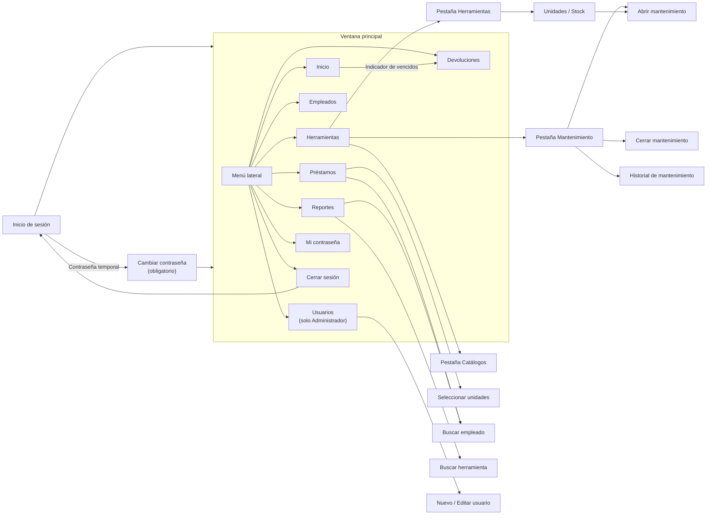

# Diseño de la interfaz

**Sistema de Control de Herramientas · PROMACO**

## 1. Criterios de diseño

La interfaz se diseñó para el encargado de herramientas, que la usa varias veces al día mientras
atiende a los empleados en la bodega. Por eso se siguieron estos criterios:

- **Rapidez en las tareas frecuentes.** Préstamos y devoluciones se resuelven en una sola pantalla,
  sin abrir ventanas intermedias.
- **El estado se entiende de un vistazo.** Cada estado tiene siempre el mismo color: verde para
  disponible, amarillo para prestada, naranja para mantenimiento y rojo para dañada, perdida o vencido.
- **Identidad de la empresa.** Se usan el azul marino y el rojo del logo de PROMACO.
- **Prevención de errores.** El sistema pide confirmación antes de las acciones que no se pueden
  deshacer y explica con un mensaje claro por qué una operación no se permite.
- **Consistencia.** Todas las pantallas comparten la misma estructura, los mismos botones, campos,
  tarjetas y tablas, y los mismos buscadores.
- **Estilo moderno y limpio.** Se tomó como referencia Material Design: superficies blancas sobre fondo
  gris claro, esquinas redondeadas, sombras suaves y animaciones breves al pasar el ratón o cambiar de
  sección.

## 2. Identidad visual

### 2.1 Colores de la marca y de la interfaz

| Uso | Color | Código |
|---|---|---|
| Marca: azul marino (logo, pantalla de inicio de sesión) | Azul marino PROMACO | `#0E004D` |
| Marca: rojo (logo, botón Ingresar) | Rojo PROMACO | `#E31C23` |
| Menú lateral | Azul marino oscuro | `#0B0B45` |
| Acción principal, enlaces, elemento seleccionado | Azul | `#0056B3` |
| Fondo de selección y de chips informativos | Azul claro | `#E0EBFF` |
| Fondo general de la aplicación | Gris muy claro | `#F5F6FA` |
| Tarjetas, paneles y tablas | Blanco | `#FFFFFF` |
| Bordes y divisores | Gris claro | `#E1E4EB` |
| Texto principal | Gris casi negro | `#191E32` |
| Texto secundario (explicaciones, etiquetas) | Gris medio | `#646E82` |

### 2.2 Colores de estado

Estos colores se repiten en tablas, tarjetas, indicadores y gráficos. Cada estado se muestra como un
**chip**, una etiqueta redondeada con el texto en color intenso sobre un fondo suave del mismo tono.

| Estado | Color del texto | Fondo del chip |
|---|---|---|
| Disponible / Bueno / Reparada | Verde `#16A34A` | `#DCFCE7` |
| Prestada | Amarillo `#CA8A04` | `#FEF9C3` |
| En mantenimiento / Correctivo | Naranja `#EA580C` | `#FFEDD5` |
| Dañada / Perdida / Vencido | Rojo `#DC2626` | `#FEE2E2` |
| Dada de baja / Inactivo | Gris `#6B7280` | `#F3F4F6` |
| Preventivo | Azul `#0056B3` | `#E0EBFF` |
| Calibración | Violeta `#7C3AED` | `#EDE9FE` |

### 2.3 Tipografía

- **Fuente:** Segoe UI, la fuente propia de Windows, que se lee bien en pantalla y tiene tildes y ñ.
- **Tamaño base:** 11 puntos para textos, campos y tablas.
- **Títulos de pantalla y de sección:** negrita, de mayor tamaño.
- **Números de los indicadores:** grandes y en negrita, para leerlos de un vistazo.
- **Chips y textos de apoyo:** 8.5 a 9.5 puntos.

### 2.4 Íconos

Se usa la colección **Font Awesome**: íconos sólidos de un mismo estilo en el menú, los botones y los
indicadores. Por ejemplo: casa (Inicio), caja de herramientas (Herramientas), mano (Préstamos),
flecha de regreso (Devoluciones), gráfico de barras (Reportes), escudo (Usuarios) y llave
(Mi contraseña).

## 3. Componentes de la interfaz

Todas las pantallas se construyen con el mismo conjunto de componentes:

| Componente | Descripción | Dónde se usa |
|---|---|---|
| **Botones** | Planos, con esquinas redondeadas, ícono opcional y cambio de color animado al pasar el ratón. Hay variantes por función: principal (azul), secundario (blanco con borde), peligro (rojo), éxito (verde) y marca (rojo PROMACO). | Todas las pantallas |
| **Campos de texto** | Sin borde de caja, con una línea inferior que se vuelve azul al escribir en ellos. | Formularios y buscadores |
| **Listas desplegables** | Con el mismo estilo que los campos de texto. | Categoría, marca, rol, tipo de mantenimiento |
| **Tarjetas** | Paneles blancos con esquinas redondeadas que agrupan la información relacionada. | Todas las pantallas |
| **Indicadores (KPI)** | Tarjeta con una franja de color a la izquierda, un ícono, un número grande y una etiqueta. Algunos se pueden presionar para ir al detalle. | Inicio, Reportes, Historial de mantenimiento |
| **Chips** | Etiquetas redondeadas de color que indican un estado o una categoría. | Tablas y encabezados |
| **Filtros por categoría** | Chips que se pueden presionar para filtrar una lista. | Herramientas, Préstamos, buscadores |
| **Control segmentado** | Grupo de botones unidos en el que solo uno está activo. | Catálogos (categorías, marcas, ubicaciones, proveedores) |
| **Selector de condición** | Tres botones: Bueno (verde), Dañado (amarillo) y Perdido (rojo). | Devoluciones, Unidades |
| **Interruptor** | Botón deslizante de encendido y apagado. | Suspender o permitir el préstamo de una herramienta |
| **Tablas** | Sin líneas verticales, con filas espaciadas, encabezado gris claro y fila seleccionada en azul claro. Las celdas pueden mostrar chips, avatares o barras. | Listados y reportes |
| **Avatar** | Círculo de color con las iniciales del empleado. | Empleados, Devoluciones, Reportes |
| **Selectores con lupa** | Campo de solo lectura con un botón de lupa que abre un buscador. | Elegir empleado o herramienta |
| **Tarjeta de herramienta** | Foto, nombre, stock disponible con color y un contador − / + para elegir cuántas piezas prestar. | Préstamos |

## 4. Estructura general

### 4.1 Mapa de navegación



### 4.2 Ventana principal

Al iniciar sesión se abre la ventana principal, que tiene siempre la misma estructura: un **menú
lateral** fijo a la izquierda y un **área de contenido** a la derecha, donde se carga la sección
elegida. Al cambiar de sección solo cambia el área de contenido, así que el usuario siempre sabe dónde
está y cómo volver.

```
┌──────────────────┬──────────────────────────────────────────────────────────┐
│  PROMACO         │  Título de la sección                       [Acciones]   │
│                  │                                                          │
│ ▌⌂ Inicio        │  ┌─────────┐ ┌─────────┐ ┌─────────┐ ┌─────────┐         │
│  ⚒ Herramientas  │  │   KPI   │ │   KPI   │ │   KPI   │ │   KPI   │         │
│  👥 Empleados     │  └─────────┘ └─────────┘ └─────────┘ └─────────┘         │
│  ✋ Préstamos     │                                                          │
│  ↺ Devoluciones  │  ┌──────────────────────┐ ┌───────────────────────────┐  │
│  📊 Reportes      │  │                      │ │                           │  │
│  🛡 Usuarios      │  │   Tarjeta / lista    │ │     Tarjeta / detalle     │  │
│                  │  │                      │ │                           │  │
│                  │  └──────────────────────┘ └───────────────────────────┘  │
│ ──────────────── │                                                          │
│  🔑 Mi contraseña │                                                          │
│  ⇥ Cerrar sesión │                                                          │
└──────────────────┴──────────────────────────────────────────────────────────┘
   Menú lateral                         Área de contenido
```

**Menú lateral:**

- Fondo azul marino oscuro, con el nombre del sistema en la parte superior.
- Cada opción tiene un ícono y un nombre. La opción activa se resalta con una píldora clara y una
  barra azul a la izquierda, que se desliza con una animación al cambiar de sección.
- La opción **Usuarios** solo aparece cuando el usuario es Administrador. Así, el Operador no ve
  funciones que no puede usar.
- **Mi contraseña** y **Cerrar sesión** están separadas al final, porque son opciones de la cuenta y
  no de la operación.

**Área de contenido:** sigue el mismo patrón en todas las secciones:

1. **Encabezado** con el título de la sección y, a la derecha, la acción principal (por ejemplo,
   *Nueva herramienta* o *Nuevo usuario*).
2. **Indicadores** cuando la sección los necesita.
3. **Cuerpo**, casi siempre dividido en **lista a la izquierda y detalle a la derecha**: el usuario
   elige un elemento de la lista y trabaja con él en el panel de detalle.

### 4.3 Ventanas emergentes

Las tareas secundarias se abren en ventanas pequeñas centradas sobre la ventana principal, que se
cierran al terminar y devuelven al usuario a donde estaba. Por ejemplo: buscar un empleado, elegir
piezas, abrir o cerrar un mantenimiento, ver el historial, crear un usuario o cambiar la contraseña.

### 4.4 Mensajes al usuario

| Tipo | Cuándo aparece | Ejemplo |
|---|---|---|
| **Confirmación** | Antes de una acción importante o que no se puede deshacer. Explica lo que va a pasar. | "Las unidades dañadas no volverán al stock hasta pasar por mantenimiento. ¿Confirmar la devolución?" |
| **Aviso** | Falta un dato obligatorio. | "Seleccione el empleado solicitante." |
| **Error** | Se intenta algo que va contra una regla del negocio. Dice el motivo. | "El empleado no puede aprobar su propio préstamo." |
| **Éxito / resumen** | Al terminar una operación. Resume lo que pasó. | "Se registró la devolución de 2 herramientas. El préstamo quedó cerrado." |
| **Error dentro del formulario** | En formularios pequeños, el error aparece en rojo dentro de la misma ventana, sin abrir otra. | Cambiar contraseña, nuevo usuario |

Si la base de datos no responde, el sistema muestra un mensaje que indica qué revisar, en lugar de
cerrarse.

## 5. Descripción de las pantallas

### 5.1 Inicio de sesión

Ventana dividida en dos paneles:

- **Izquierda:** el logo de PROMACO y el nombre del sistema sobre un degradado azul marino, con una
  línea roja de la marca.
- **Derecha:** sobre fondo blanco, los campos *Usuario* y *Contraseña* y el botón **Ingresar** en rojo
  PROMACO.

Si el usuario entra con una contraseña temporal, se abre de inmediato la ventana para cambiarla.

### 5.2 Inicio (panel de control)

Es la primera pantalla después de iniciar sesión. Reúne todo lo que el encargado necesita revisar en
el día:

- **Fila de indicadores:** préstamos vencidos (en rojo), préstamos activos, piezas disponibles, en
  mantenimiento y dañadas. El indicador de vencidos lleva directamente a Devoluciones.
- **Gráfico de dona** con las piezas por estado.
- **Gráfico de líneas** con préstamos y devoluciones de los últimos 30 días.
- **Gráfico de barras** con los préstamos activos por departamento.
- **Próximas devoluciones**, con los vencidos marcados con una etiqueta roja.
- **Herramientas sin stock y alertas activas.**
- **Actividad del día.**

### 5.3 Herramientas

Pantalla con tres pestañas:

1. **Herramientas:**
   - A la izquierda, la lista con un buscador y chips para filtrar por categoría.
   - A la derecha, el detalle de la herramienta seleccionada: foto, datos editables (nombre,
     características, categoría, marca y ubicación) y tarjetas de stock (total, disponibles,
     prestadas, en mantenimiento y dañadas) con sus colores de estado, más las últimas piezas.
   - Botones: *Nueva herramienta*, *Guardar cambios*, *Cambiar foto*, *Unidades / Stock* y
     *Dar de baja*.
2. **Catálogos:** un control segmentado para elegir entre categorías, marcas, ubicaciones y
   proveedores; una tabla con los registros y cuántas herramientas usan cada uno; y un formulario para
   agregar, editar o eliminar.
3. **Mantenimiento:** dos grupos, *mantenimientos activos* (chip naranja) y *pendientes de reparar*
   (piezas dañadas, chip rojo, con quién las devolvió y su nota). Al seleccionar una fila aparece una
   barra con la acción que corresponde: *Enviar a mantenimiento* o *Cerrar mantenimiento*, además de
   *Ver historial*.

**Ventanas relacionadas:**

- **Unidades / Stock:**
  - En el encabezado, el nombre de la herramienta, chips con el stock y el interruptor
    *Préstamos activos / suspendidos*.
  - Una tabla con una fila por pieza: casilla para marcarla, código, estado (chip) y selector de
    condición.
  - Al marcar piezas aparece una barra de acciones (dar de baja, marcar como dañada o perdida, enviar a
    mantenimiento).
  - En el pie, un campo para agregar piezas nuevas.
- **Abrir mantenimiento:** arriba, la lista de piezas con casillas, con las dañadas primero. Abajo,
  el tipo de mantenimiento, si es interno o externo, quién lo realiza y la descripción del trabajo.
- **Cerrar mantenimiento:** el resultado (reparada o baja); los costos de materiales y de mano de
  obra, con el total en lempiras calculado al momento; la casilla de garantía, que pone los costos en
  cero; el folio de la factura y las notas.
- **Historial de mantenimiento:** cuatro indicadores (cantidad, costo total, duración promedio y
  correctivos), una tabla con chips de tipo y de resultado, y un panel inferior con el detalle del
  mantenimiento seleccionado.

### 5.4 Empleados

Lista de solo consulta de los empleados que vienen del sistema de Recursos Humanos. Tiene buscador,
filtro por departamento, avatar con las iniciales y chip del departamento. Desde aquí se sincroniza la
lista con RRHH.

### 5.5 Préstamos

Pantalla dividida en dos columnas:

- **Izquierda (formulario):**
  - El selector del empleado solicitante.
  - La sección *Aprobación y fechas*, donde el aprobador aparece automáticamente y no se puede editar,
    y se elige la fecha de devolución.
  - Un resumen de las herramientas seleccionadas y el botón **Guardar préstamo**.
- **Derecha (catálogo):** tarjetas de las herramientas disponibles, con foto, nombre y stock
  disponible en color (verde con 3 o más, naranja con 1 o 2, rojo sin piezas). Cada tarjeta tiene un
  contador − / + que asigna piezas automáticamente y un enlace *Ver unidades ›* para elegir piezas
  concretas. La tarjeta se marca con borde azul cuando tiene piezas seleccionadas. Arriba hay un
  buscador y filtros por categoría.

Esta distribución permite registrar un préstamo completo sin salir de la pantalla.

### 5.6 Devoluciones

- **Izquierda:** la lista de préstamos con piezas pendientes, con buscador por empleado o código. Los
  vencidos se distinguen en rojo.
- **Derecha:**
  - Los datos del empleado y del préstamo, con una alerta si está vencido.
  - Una fila por cada pieza pendiente, con el selector de condición (Bueno, Dañado o Perdido) y un
    campo de nota.
  - Los botones **Devolver seleccionadas** y **Devolver todo**.

### 5.7 Reportes

- **Arriba:** indicadores generales.
- **Tarjetas de reportes:** una por reporte, con ícono, nombre y descripción. La tarjeta elegida se
  resalta en azul.
- **Barra de filtros:** cambia según el reporte (rango de fechas, empleado, herramienta, categoría).
  A la derecha están los botones **Generar**, **Excel** y **PDF**.
- **Tabla de resultados:** con chips de estado, avatares, barras de uso y posiciones de ranking.

### 5.8 Usuarios (solo Administrador)

- **Encabezado:** el título y el botón **Nuevo usuario**.
- **Tabla:** usuario, empleado, rol, estado (activo o inactivo) y situación de la contraseña (por
  ejemplo, si es temporal).
- **Barra de acciones** para el usuario seleccionado: *Editar*, *Restablecer contraseña* y
  *Activar / Desactivar*.
- **Ventana Nuevo / Editar usuario:** el selector del empleado, el nombre de usuario y el rol, con la
  descripción de lo que puede hacer cada rol. Al crear el usuario se muestra la contraseña temporal,
  que queda copiada para entregarla.

### 5.9 Mi contraseña

Ventana pequeña con los campos *contraseña actual*, *nueva contraseña* y *confirmación*. Muestra las
reglas que debe cumplir la contraseña, y los errores aparecen en rojo dentro de la misma ventana.

## 6. Usabilidad

- **Buscadores sin tildes:** al buscar "tecnico" se encuentra "Técnico".
- **Uso con teclado en los buscadores:** la flecha abajo o Enter pasan a la lista, Enter elige el
  elemento y, si se sigue escribiendo, se sigue buscando.
- **Doble clic** en una fila abre su edición, por ejemplo en Usuarios.
- **Valores calculados por el sistema:** el aprobador, los códigos de herramientas y piezas, el stock
  y el total de un mantenimiento no se escriben a mano. Así se evitan errores de digitación.
- **Opciones según el estado:** una pieza prestada no permite cambiar su condición, y la barra de
  mantenimiento solo muestra la acción que corresponde a la fila elegida.
- **Fotos de las herramientas:** ayudan a identificar la herramienta correcta. Si una herramienta no
  tiene foto, se muestra un ícono genérico.
